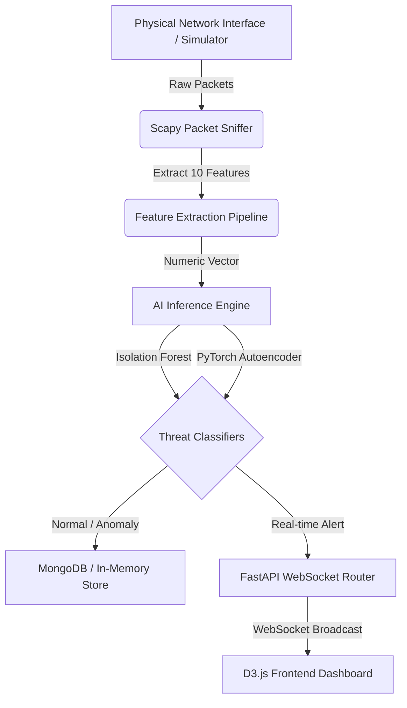

# NetSentinel: AI-Powered Network Intrusion & Cyber Threat Visualizer

NetSentinel is a full-stack real-time network monitoring and cybersecurity threat detection suite. It captures incoming traffic, extracts multi-dimensional features, runs real-time classification using PyTorch Autoencoders and Isolation Forests, stores logs, and visualizes network topology interactively via D3.js.

---

## 1. System Architecture



### Key Technical Stack:
- **AI/ML Layer**: PyTorch (Autoencoder), Scikit-Learn (Isolation Forest & StandardScaler).
- **Backend Service**: FastAPI, Motor (Async MongoDB), Scapy (Packet Capture).
- **Frontend Layer**: D3.js (Force graph & Zoom controls), HTML5/CSS3 (Sleek dark mode glassmorphism UI).

---

## 2. Feature Vectors (10 Dimensions)

Each captured packet gets processed into a 10-dimensional numeric vector:
1. **Packet Size**: Raw packet length (Bytes).
2. **Protocol ID**: Numerical protocol identifier (TCP=6, UDP=17, ICMP=1, ARP=2054, Other=0).
3. **Source IP**: 32-bit converted integer representation of the source IPv4 address.
4. **Destination IP**: 32-bit converted integer representation of the destination IPv4 address.
5. **TTL**: Time to Live value from the IP header.
6. **Flags**: Hex/integer converted TCP flag bitmask.
7. **Source Port**: Source socket port (0 if protocol has no ports).
8. **Destination Port**: Destination socket port (0 if protocol has no ports).
9. **Inter-Arrival Time**: Time interval (seconds) since the previously ingested packet.
10. **Byte Entropy**: Shannon entropy calculated across the raw packet payload byte distribution (value between 0.0 and 8.0).

---

## 3. Unsupervised AI Models

### A. PyTorch Autoencoder
- **Architecture**: A symmetric compression/reconstruction neural network (Input 10D -> 8D -> 4D bottleneck -> 8D -> Output 10D).
- **Inference**: High reconstruction mean squared error (MSE) indicates packet characteristics differing from the normal training baseline.
- **Threshold**: Standard threshold set at the 95th percentile of validation errors.

### B. Isolation Forest
- **Architecture**: Tree-based ensemble isolation structure.
- **Inference**: Isolates anomalies faster by splitting random features. Yields negative decision scores for anomalies.

---

## 4. API Documentation

### GET `/alerts`
Retrieves a list of the latest network threat alerts.
* **Query Params**: `limit` (default: 50)
* **Response**: List of Alert objects.

### GET `/topology`
Retrieves connection details to render the node graph.
* **Response**: `{"nodes": [...], "edges": [...]}`

### POST `/predict`
Runs custom on-demand prediction.
* **Payload**: `{"features": [size, proto, src_ip, dst_ip, ttl, flags, sport, dport, inter_arrival, entropy]}`
* **Response**: Anomaly classification level, decision scores, and severity color.

### WS `/ws/packets`
WebSocket stream broadcasting live raw packet metrics and alerts in JSON format.

---

## 5. Quick Setup & Run

### Prerequisites
- Python 3.8+
- (Optional) MongoDB running locally on port 27017.
- (Optional, for physical sniffer) Npcap/WinPcap on Windows or libpcap on Linux/macOS.

### Instructions

1. **Install Requirements**:
   ```bash
   pip install -r netsentinel/requirements.txt
   ```

2. **Train the Models**:
   Run the training script to fit standard models and standard scaler binaries:
   ```bash
   python netsentinel/models/model_train.py
   ```

3. **Start the FastAPI Server**:
   ```bash
   uvicorn netsentinel.backend.main:app --reload --port 8000
   ```

4. **Access the Dashboard**:
   Open a web browser and go to `http://localhost:8000`. The interface will automatically stream live packet data. If no physical interface is captured, it automatically falls back to simulated threat generators (DDoS SYN Flood, Port Scans, Brute Force, Exfiltration) to showcase dynamic D3.js alerts.
